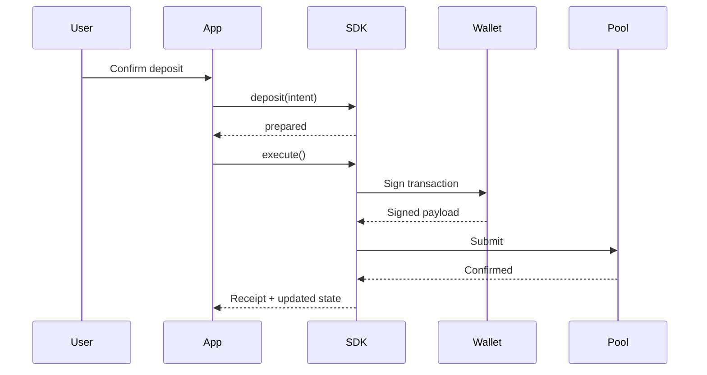

import { OperationDisclosures } from '../snippets/operation-disclosures.jsx';

Call `deposit`, `transfer`, or `withdraw` with the same intent shape. Each call **prepares**, then you **execute**.

For Stellar code, see [Deposit](/application-development/how-to/deposit).

## Shared operation inputs

| Field | Meaning |
| --- | --- |
| `from` | Source address — public wallet or private payment address depending on the operation |
| `to` | Destination address — same address types as `from` |
| `asset` | Asset ID from your catalog |
| `amount` | Transfer amount in the asset's smallest unit |
| `disclosure` | Per-field on-chain visibility — see [Disclosure policy](/concepts/disclosure-policy) |

```ts
const operation = await client.deposit({
  from: '...',
  to: '...',
  asset: 'usdc',
  amount: 50_0000000n,
  disclosure: {
    senderAddress: 'public',
    recipientAddress: 'private',
    assetAddress: 'public',
    amount: 'public',
  },
});
```

## Deposit

Move value from a **public wallet balance** into a **private pool note**.

1. **Prepare** — validate asset catalog, pool state, wallet secrets, and disclosure policy.
2. **Execute** — sign and submit the pool deposit; emit encrypted audit data per policy.
3. **After success** — SDK adds a new private record and updates pool state in local storage.

**Typical disclosure:**

<OperationDisclosures operation="deposit" />

## Withdraw

Spend a **private pool note** and pay out to a **public wallet**.

1. **Prepare** — select note(s) covering the amount, validate pool root, check disclosure.
2. **Execute** — submit pool withdrawal; move public asset to the recipient account.
3. **After success** — mark consumed record(s); persist change note if amount exceeds withdrawal.

**Typical disclosure:**

<OperationDisclosures operation="withdraw" />

Private sender on this route requires Protocol Relay. Direct `execute()` is for public-sender / positive public deposit.

## Public withdraw

Spend one **private pool note** and pay its full value to the **connected public wallet**. Sender, recipient, asset, and amount are public.

1. **List** — `listPublicWithdrawNotes` returns unspent notes from local state.
2. **Prepare** — match one note by asset and amount. Pass `noteId` when more than one note matches.
3. **Execute** — the payout address signs and the pool pays the whole note. No change note is created.

**Disclosure:**

<OperationDisclosures operation="public-withdraw" />

See [Public withdraw](/application-development/how-to/public-withdraw).

## Transfer to registered recipient

Spend a sender note and create output note(s) for a recipient who is **already in the registry cache**.

1. **Prepare** — resolve recipient private payment address from registry lookup; validate sender balance.
2. **Execute** — submit pool transact with recipient output and optional sender change.
3. **After success** — update consumed/sender records and add recipient/change records.

**Typical disclosure:**

<OperationDisclosures operation="transfer-registered" />

Private sender on this route requires Protocol Relay.

## Transfer to unregistered recipient (escrow send)

Send to a **public wallet** when the recipient has not registered a private address yet. The prepared transaction stays indistinguishable from an ordinary private transfer.

1. **Prepare** — validate sender state and use private disclosure (recipient/asset/amount private).
2. **Execute** — preset derives an escrow note owner from a random nonce and the recipient G-address. Public escrow recipient limbs stay zero.
3. **Submit** — escrow sends require Protocol Relay and a zero public deposit.

Requires `transactEnvironment` hooks. See [Transfer to unregistered recipient](/application-development/how-to/transfer-unregistered-recipient).

**Typical disclosure:**

<OperationDisclosures operation="transfer-unregistered" />

## Operation comparison

| Operation | Typical `from` | Typical `to` | Registry | Compliance check |
| --- | --- | --- | --- | --- |
| Deposit | Public wallet | Private payment | Optional | Often yes |
| Withdraw | Private payment | Public wallet | No | Often yes |
| Public withdraw | Private payment | Connected public wallet | Note owner | No |
| Transfer (registered) | Private payment | Private payment | Required cache | Often yes |
| Transfer (unregistered) | Private payment | Public wallet | Unregistered lookup | Often yes |

<Note>
  Stellar addresses, seed-state fixtures, and full code blocks live in the [how-to guides](/application-development/how-to/deposit). Seed state blocks are **documentation fixtures**, not production onboarding — see [State methods](/integration/data-sources).
</Note>

## Deposit sequence



## Related

<CardGroup cols={2}>
  <Card title="Operation lifecycle" href="/concepts/operation-lifecycle">
    Prepare, execute, errors, and progress events.
  </Card>
  <Card title="Disclosure policy" href="/concepts/disclosure-policy">
    Public vs private fields per route.
  </Card>
  <Card title="State methods" href="/integration/data-sources">
    Production vs fixture state.
  </Card>
</CardGroup>
