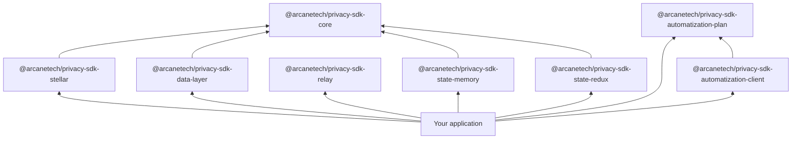
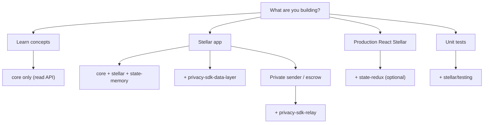

import { PackageMatrix } from '../snippets/package-matrix.jsx';

All public packages use the `@arcanetech` scope and are published on npm. Install the Stellar preset, a state adapter, the private-data client when you read private records, and the optional Protocol Relay runtime explicitly. **No additional cryptography packages** are required for browser or Node.

## Package map

<PackageMatrix />

`@arcanetech/privacy-sdk-stellar` ships bundled runtime assets for browser and Node. Pass network configuration, a wallet adapter, a state adapter, and policy — the preset handles the rest. To read private records, add [`@arcanetech/privacy-sdk-data-layer`](https://www.npmjs.com/package/@arcanetech/privacy-sdk-data-layer) — see [Private records package](#private-records). For private sender or escrow sends, add [`@arcanetech/privacy-sdk-relay`](https://www.npmjs.com/package/@arcanetech/privacy-sdk-relay) — see [Protocol Relay package](#protocol-relay). Public withdraw is [`publicWithdraw`](/application-development/how-to/public-withdraw).

## Layered architecture



- **Plan** — a Plan for one asset. Check that it is funded, which Step is underfunded, and whether a Step is executed or blocked. You pass a presence report. This package does not query a chain.
- **Plan progress** — show a saved Plan. List each Row. List each Payout account. List each Payout's public amount. List each pinned note. List each Step's Free tokens. You pass which pinned nullifiers are consumed. You pass which pinned commitments are in the pool tree. The package marks each Step executed. The package marks each Step blocked.
- **Core** — intents, prepare/execute lifecycle, errors, progress events, and the private-data authorization envelope.
- **Private data** — HTTP client for private records. You pass the schemas. `find` returns records only after your schema accepts the payload. Challenge methods stop before a request when you omit the completion schema.
- **Relay** — Protocol Relay runtime: admission, polling, retry, and fallback over caller-supplied ports. It owns statuses, reason codes, and package JSON serialization, follows a caller-supplied submission path, and never inspects opaque package payloads or deposit amounts. Relaying is enabled only when the caller sets `relayConfig.origin`; otherwise the runtime Direct-submits and does not contact a relayer. Settlement polling is bounded. The package does not depend on Stellar or Soroban.
- **State adapters** — persistence for SDK domain state.
- **Network preset** — `@arcanetech/privacy-sdk-stellar`: client, contract bindings, and state schema extensions.

Internal transitive dependencies are not part of the public integration surface.

## Entry points and subpaths

**Shared packages:**

| Import                                                                                         | Purpose                                                                                                                 |
| ---------------------------------------------------------------------------------------------- | ----------------------------------------------------------------------------------------------------------------------- |
| `@arcanetech/privacy-sdk-automatization-client`                                                | Plan progress. Rows, Payouts, pinned notes, Free tokens, executed and blocked Steps                                     |
| `@arcanetech/privacy-sdk-automatization-plan`                                                  | Plan document. Funded, underfunded, executed, and blocked checks                                                        |
| `@arcanetech/privacy-sdk-core`                                                                 | Intents, lifecycle helpers, error types, progress events, authorization envelope                                        |
| `@arcanetech/privacy-sdk-data-layer`                                                           | Private-record HTTP client. Checks caller-supplied schemas before returning                                             |
| [`@arcanetech/privacy-sdk-relay`](https://www.npmjs.com/package/@arcanetech/privacy-sdk-relay) | Protocol relay runtime (ports, polling, retry, fallback) and the wire vocabulary (statuses, reason codes, package JSON) |
| `@arcanetech/privacy-sdk-state-memory`                                                         | In-memory state adapter for prototypes and tests                                                                        |
| `@arcanetech/privacy-sdk-state-redux`                                                          | Redux Toolkit adapter for React apps                                                                                    |

**Stellar preset:**

| Import                                     | Purpose                                                                                                                                                                                 |
| ------------------------------------------ | --------------------------------------------------------------------------------------------------------------------------------------------------------------------------------------- |
| `@arcanetech/privacy-sdk-stellar`          | Browser client factory and Stellar types                                                                                                                                                |
| `@arcanetech/privacy-sdk-stellar/transact` | Stellar transaction helpers, including `requiredSubmissionMethod`, `buildBlindedRecipientTagChallengeMessage`, `fetchEscrowOutputNoteEvents`, and `unsignedEscrowAuthorizationForSweep` |
| `@arcanetech/privacy-sdk-stellar/node`     | Node client with filesystem asset loading                                                                                                                                               |
| `@arcanetech/privacy-sdk-stellar/testing`  | Fake transact engine for unit tests                                                                                                                                                     |

## Stellar preset {#stellar-preset}

Use `@arcanetech/privacy-sdk-stellar` for **Stellar** with **Soroban** smart contracts:

- **Pool contract** — private deposits, transfers, withdrawals, and public withdrawals.
- **`publicWithdraw()`** — spends one private note and pays its full value to the connected wallet. Sender, recipient, asset, and amount are public. See [Public withdraw](/application-development/how-to/public-withdraw).
- **`assessIncomingNote()`** — reports whether a decrypted incoming note is spendable, still pending, or dead before you credit the balance. See [State methods](/integration/data-sources#check-an-incoming-note).
- **Private-address registry** — maps public Stellar accounts to private payment addresses.
- **Soroban RPC** — submission and confirmation.
- **`createStellarPrivacyClient()`** — main browser entrypoint.
- **`requiredSubmissionMethod(prepared, zkConfigNonce?)`** — Direct Submission vs Protocol Relay for a prepared operation (positive public deposits stay direct; a zero public deposit uses relay). Pass the same `zkConfigNonce` as the pool (SDK default `3`) so public-signal layout matches. Escrow sends require relay and a zero public deposit; a positive public deposit is refused rather than downgraded. Escrow sweeps use Direct Submission so the claimant wallet signs the envelope.
- **`buildBlindedRecipientTagChallengeMessage(fields)`** — wallet-signed challenge string used to issue blinded recipient tags so a recipient can discover escrow notes after they register. See [Transfer to unregistered recipient](/application-development/how-to/transfer-unregistered-recipient#discover-notes-sent-before-registration).

**Address model:**

| Type            | Format                 | Used for                          |
| --------------- | ---------------------- | --------------------------------- |
| Public wallet   | Stellar `G...` account | On-chain identity, public payouts |
| Private payment | `stpl1...` address     | Pool notes and private sends      |

**Bootstrap helpers:**

- `loadDefaultStellarBrowserAssets()` — bundled SDK WASM for the browser. Circuit schemes are selected by `zkConfigNonce`: **`3`** (2×2, default) and **`7`** (6×6).
- `transactEnvironment` — network, KYT, optional `zkConfigNonce` / `zkArtifactBaseUrl`, and transaction signing hooks passed at client creation.

For React wiring and operation examples, continue to [Stellar application development](/application-development/setup).

## Private records package {#private-records}

Install [`@arcanetech/privacy-sdk-data-layer`](https://www.npmjs.com/package/@arcanetech/privacy-sdk-data-layer) when the app reads private records. Use the `release-v0` tag. That tag publishes `0.1.0`.

```bash
npm install @arcanetech/privacy-sdk-data-layer@release-v0
```

`createPrivateDataProvider` returns `find`, `createChallenge`, and `completeChallenge`. Pass a Zod schema for each record. Pass a completion schema, a protocol, and an authorizer when the read needs a signed challenge. The provider returns a value only after your schema accepts it. `@arcanetech/privacy-sdk-core` rejects a challenge or proof that misses the authorization envelope before a request is sent.

Omit `completionSchema` when you only list records. `createChallenge` and `completeChallenge` then stop before a request.

Supply the record schema, data type, and protocol for your records. After you decrypt an incoming note, call [`assessIncomingNote`](/integration/data-sources#check-an-incoming-note) before you add it to the spendable balance. To pay a note's full value to the connected wallet, use [Public withdraw](/application-development/how-to/public-withdraw).

## Check a Plan {#plan-document}

Decide whether a Plan is funded, which Step is underfunded, and whether a Step is executed or blocked. Install the package.

```bash
npm install @arcanetech/privacy-sdk-automatization-plan
```

Build one Deposit and one Payout. Read each pinned note's plaintext, commitment, and nullifier hash. Read Free tokens and the interval from each Step. Read the account and public amount from the Payout. Set `transactionId` only after that Step is submitted.

```ts
import type { Plan } from '@arcanetech/privacy-sdk-automatization-plan';

const remainder = {
  plaintext: { amount: 8n, accumulator: 'pin-transfer' },
  commitment: 'commitment-remainder',
  nullifierHash: 'nullifier-remainder',
};

const afterTransfer = {
  plaintext: { amount: 7n, accumulator: 'pin-withdrawal' },
  commitment: 'commitment-after-transfer',
  nullifierHash: 'nullifier-after-transfer',
};

const plan: Plan = {
  rows: [
    {
      kind: 'deposit',
      amount: 10n,
      step: {
        freeTokens: 2n,
        interval: 0n,
        pinnedInputs: [],
        pinnedOutputs: [remainder],
        transactionId: 'tx-deposit',
      },
    },
    {
      kind: 'payout',
      account: 'bob-account',
      amount: 6n,
      transfer: {
        freeTokens: 1n,
        interval: 0n,
        pinnedInputs: [remainder],
        pinnedOutputs: [afterTransfer],
      },
      withdrawal: {
        freeTokens: 1n,
        interval: 0n,
        pinnedInputs: [afterTransfer],
        pinnedOutputs: [],
      },
    },
  ],
};
```

Call `isFundedPlan` and `underfundedSteps` on that Plan. Call `isExecutedStep` and `isBlockedStep` with a report of which pinned nullifiers are consumed and which pinned commitments are in the pool tree.

```ts
import {
  isBlockedStep,
  isExecutedStep,
  isFundedPlan,
  underfundedSteps,
  type PinnedNotePresence,
} from '@arcanetech/privacy-sdk-automatization-plan';

const payout = plan.rows[1];
if (payout?.kind !== 'payout') {
  throw new Error('expected a Payout');
}

const presence: PinnedNotePresence = {
  consumedNullifierHashes: ['nullifier-remainder'],
  outputCommitmentsInPoolTree: ['commitment-after-transfer'],
};

const funded = isFundedPlan(plan);
const shortfalls = underfundedSteps(plan);
const executed = isExecutedStep(payout.transfer, presence);
const blocked = isBlockedStep(payout.transfer, presence);
```

`funded` is true because the Deposit of 10 equals the Payout of 6 plus Free tokens 2, 1, and 1. `shortfalls` is empty: the transfer spends the Remainder the Deposit left, and the withdrawal spends the note that transfer left. `executed` is true for that transfer. `blocked` is false.

The note plaintext stores the amount and the accumulator. It does not store an owner scalar. Fee notes and Unspent notes are not stored on the Plan and are not part of the executed check.

## Show Plan progress {#plan-progress}

Show each Row of a saved Plan and how far each Step has gone. Install the client package.

```bash
npm install @arcanetech/privacy-sdk-automatization-client
```

Build one Deposit and one Payout.

```ts
import type { Plan } from '@arcanetech/privacy-sdk-automatization-plan';

const remainder = {
  plaintext: { amount: 8n, accumulator: 'pin-transfer' },
  commitment: 'commitment-remainder',
  nullifierHash: 'nullifier-remainder',
};

const afterTransfer = {
  plaintext: { amount: 7n, accumulator: 'pin-withdrawal' },
  commitment: 'commitment-after-transfer',
  nullifierHash: 'nullifier-after-transfer',
};

const plan: Plan = {
  rows: [
    {
      kind: 'deposit',
      amount: 10n,
      step: {
        freeTokens: 2n,
        interval: 0n,
        pinnedInputs: [],
        pinnedOutputs: [remainder],
      },
    },
    {
      kind: 'payout',
      account: 'bob-account',
      amount: 6n,
      transfer: {
        freeTokens: 1n,
        interval: 0n,
        pinnedInputs: [remainder],
        pinnedOutputs: [afterTransfer],
      },
      withdrawal: {
        freeTokens: 1n,
        interval: 0n,
        pinnedInputs: [afterTransfer],
        pinnedOutputs: [],
      },
    },
  ],
};
```

Pass that Plan and a report of which pinned nullifiers are consumed and which pinned commitments are in the pool tree.

```ts
import type { PinnedNotePresence } from '@arcanetech/privacy-sdk-automatization-plan';
import { planProgress } from '@arcanetech/privacy-sdk-automatization-client';

const presence: PinnedNotePresence = {
  consumedNullifierHashes: ['nullifier-remainder'],
  outputCommitmentsInPoolTree: ['commitment-after-transfer'],
};

const progress = planProgress(plan, presence);
```

Read the Deposit amount. Read the Payout account and public amount. Read the transfer Step's pinned notes and Free tokens. Read whether that Step is executed or blocked.

```ts
const deposit = progress.rows[0];
const payout = progress.rows[1];
if (deposit?.kind !== 'deposit' || payout?.kind !== 'payout') {
  throw new Error('expected a Deposit and a Payout');
}

const depositAmount = deposit.amount;
const account = payout.account;
const amount = payout.amount;
const pinnedInputs = payout.transfer.pinnedInputs;
const pinnedOutputs = payout.transfer.pinnedOutputs;
const freeTokens = payout.transfer.freeTokens;
const executed = payout.transfer.executed;
const blocked = payout.transfer.blocked;
```

`depositAmount` is 10. `account` is `bob-account`. `amount` is 6. `pinnedInputs` is the Remainder. `pinnedOutputs` is the next pinned note. `freeTokens` is 1. `executed` is true. That transfer's pinned input nullifier is consumed. Its pinned output commitment is in the pool tree. `blocked` is false.

Each Step shows Free tokens as an amount. The view has no Service scalar. The view has no Execution material. You pass the presence report.

## Protocol Relay package {#protocol-relay}

Install [`@arcanetech/privacy-sdk-relay`](https://www.npmjs.com/package/@arcanetech/privacy-sdk-relay) when the sender must stay private (zero public deposit) or you send to an unregistered recipient (escrow). Typical deposits keep the sender public and stay on Direct Submission — they do not need this package. The runtime does not depend on Stellar or Soroban.

```bash
npm install @arcanetech/privacy-sdk-relay
```

The package owns admission, lifecycle polling, retry, and consented Direct-submit fallback. Callers supply five required ports (`store`, `submitDirect`, `finalizeLocalState`, `drainDeliveries`, `persistUserTransaction`). Relaying is off until `relayConfig.origin` is set; an unset origin Direct-submits and never contacts a relayer. `origin` may include a URI path prefix (for example `https://payments.example/api`). The runtime does not inspect opaque package payloads and has no Stellar, Soroban, or zero-knowledge dependencies.

Main exports: `createRelayApi`, `resolveRelayOrigin`, `submitAndAwaitPrivateOperation`, `throwIfRelayUnsuccessful`, `serializeRelayPackage` / `deserializeRelayPackage`, `resumePendingOperations`, `retryFailedRelayAttempt`.

See [Examples](/integration/quick-start) for runnable Relay wiring after `requiredSubmissionMethod`. Operation detail: [Withdraw](/application-development/how-to/withdraw) and [Transfer to unregistered recipient](/application-development/how-to/transfer-unregistered-recipient).

## Which packages you need



### Frontend vs backend package set

| Path | Packages |
| --- | --- |
| **Frontend** (browser wallet) | `@arcanetech/privacy-sdk-stellar` + `@arcanetech/privacy-sdk-state-redux` + `@arcanetech/privacy-sdk-relay` (wallet kit is outside the SDK) |
| **Backend** (Node signing) | `@arcanetech/privacy-sdk-stellar/node` + `@arcanetech/privacy-sdk-state-memory` + `@arcanetech/privacy-sdk-relay` |

Runnable demos: [Examples](/integration/quick-start).

## Related

<CardGroup cols={2}>
  <Card title="Set up the SDK" href="/integration/getting-access">
    npm install and where live stand values come from.
  </Card>
  <Card title="State adapters" href="/integration/state-integration">
    Choose in-memory or Redux state adapters.
  </Card>
  <Card title="Examples" href="/integration/quick-start">
    Frontend or backend demo.
  </Card>
  <Card title="Install" href="/application-development/setup">
    Install the Stellar React stack.
  </Card>
</CardGroup>
